 

**B.Tech CSE with Applied AI · St Joseph University**

*Python · Problem Solving · Software Development*

[GitHub](https://github.com/aravindisdev) · [LinkedIn](https://www.linkedin.com/in/aravindisdev) · [Email](mailto:aravindisdev@gmail.com)

---

## About

I'm Aravind P, a B.Tech Computer Science and Engineering student studying Applied AI at St Joseph University.

I learn by building, testing ideas, reading documentation, and debugging problems. My current focus is strengthening Python and programming fundamentals while exploring backend development and applied AI.

- **Building with:** Python and APIs
- **Learning:** Data Structures & Algorithms, web development, and software engineering fundamentals
- **Working style:** Learn → Build → Break → Debug → Understand → Improve
- **Approach:** Use documentation, test assumptions, and understand the code rather than blindly accepting generated output

## Selected work

### [LeetCodeReminder](https://github.com/aravindisdev/LeetCodeReminder)

A Python Telegram bot designed to remind me to solve the LeetCode Daily Challenge.

### More repositories

Explore the rest of my work on [GitHub](https://github.com/aravindisdev?tab=repositories). I’m keeping this section focused on projects with a public repository rather than listing unfinished ideas as completed work.

## Skills

| Category | Current focus |
| --- | --- |
| Language | Python |
| Fundamentals | Problem solving, programming fundamentals |
| Also learning | C++ basics, Data Structures & Algorithms, web development |
| Tools | Git, GitHub, VS Code, AI coding tools |
| Development | Working with APIs through documentation; debugging and iteration |

## GitHub activity

View my real contribution history on [my GitHub profile](https://github.com/aravindisdev?tab=overview).

The contribution graph below is rendered by GitHub itself, so the activity is not manually estimated.

If the external chart service is unavailable, use the contribution graph on my GitHub profile.

## Find me

- **GitHub:** [@aravindisdev](https://github.com/aravindisdev)
- **LinkedIn:** [aravindisdev](https://www.linkedin.com/in/aravindisdev)
- **X:** [@aravindisdev](https://x.com/aravindisdev)
- **Instagram:** [@aravindisdev](https://instagram.com/aravindisdev)
- **Email:** [mailsofaravind@gmail.com](mailto:aravindisdev@gmail.com)

---

Still learning. Still building.

